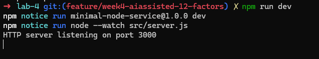

# Minimal HTTP Service

Small HTTP service built with Node.js, JavaScript, and Express. It exposes `GET /health` to verify that the process is available and is prepared to run locally or as a Node.js function on Vercel.

## Quick start

```bash
npm install
cp .env.example .env
npm run dev
```



With the server running:

```bash
curl http://localhost:3000/health
```


Response:

```json
{
  "status": "ok"
}
```

## Technologies and structure

- Node.js and JavaScript with ES modules.
- Express for the HTTP service.
- `src/app.js`: application and routes.
- `src/server.js`: local execution, logs, and controlled shutdown.
- `api/index.js`: Vercel serverless entrypoint that reuses `src/app.js`.
- `skills/`: reusable review checklists.
- `promt/`: prompt used to guide collaboration with AI.

## Environment variables

| Variable | Purpose | Local value |
|---|---|---|
| `PORT` | Port where the local server listens. | `3000` |

The variable is documented in `.env.example`. No real secrets are stored in the repository. On Vercel, the platform manages the port.

## Scripts

| Command | Purpose |
|---|---|
| `npm run dev` | Runs the local server with automatic restart. |
| `npm start` | Runs the server without watch mode. |
| `npm run build` | Confirms that this service does not require a compilation step. |

## Endpoint and test

`GET /health` returns JSON with the service status.

```bash
curl http://localhost:3000/health
```

The local test performed with `PORT=3147` returned:

```text
{"status":"ok"}
```

The process also received `SIGTERM` and logged the controlled server shutdown.

## Twelve-Factor mapping

| Factor | How it is implemented | Evidence |
|---|---|---|
| Codebase | All code belongs to a single versionable project. | Repository |
| Dependencies | Express is declared and resolved versions are recorded in the lockfile. | `package.json`, `package-lock.json` |
| Config | The port is read from `PORT` and no secrets are stored. | `.env.example`, `src/server.js` |
| Backing services | No database, queue, or external API is needed to answer `/health`. | `src/app.js`, `package.json` |
| Build, release, run | `build` does not compile; `start` runs the service and Vercel manages the release. | `package.json`, `vercel.json` |
| Processes | The application does not store sessions or persistent files. | `src/app.js` |
| Port binding | Express uses `PORT`, with `3000` only as a local default. | `src/server.js` |
| Concurrency | The process is independent and Vercel can create instances according to demand. | `src/server.js`, `api/index.js` |
| Disposability | `SIGTERM` and `SIGINT` close the listener before the process exits. | `src/server.js` |
| Dev/prod parity | The same app is used locally and as a Vercel function. | `src/app.js`, `api/index.js` |
| Logs | Operational events are written to stdout/stderr, not local files. | `src/server.js` |
| Admin processes | There are no migrations, cron jobs, or administrative tasks because there is no storage. | `package.json`, `src/` |

Backing services and Admin processes do not add components because this service has no external dependencies or storage. If the scope grows, they should be documented and configured as independent services or processes.

## Vercel deployment

The `api/` folder is required for this design because Vercel detects its files as serverless functions. `api/index.js` reuses the application from `src/app.js`; `src/` keeps the application logic and local startup.

To deploy, import the repository into Vercel or run `vercel` with an authenticated account. Then check:

```bash
curl https://<generated-domain>/health
```

Deployment was not executed in this environment because the Vercel CLI and credentials are not available.

Vercel URL: [insert real URL]

## AI collaboration and reflection

The prompt in [`promt/twelve-factor.md`](promt/twelve-factor.md) was used to simulate and organize the development process: requirements analysis, structure proposal, implementation, quality review, testing, and documentation.

The AI proposed separating the Express application from local startup and creating `api/index.js` to reuse the same application on Vercel. That separation was accepted, while unnecessary components such as a database, external logging, and a real compilation stage were rejected. The table was also adjusted to explain each of the twelve factors individually.

Using AI to generate alternatives, identify missing evidence, and prepare checklists worked well. The final changes were reviewed and checked by running Node.js, `npm run build`, `curl`, and a `SIGTERM` termination.

Next steps toward full compliance are completing the Vercel deployment, recording the public URL, linking the repository, and adding the final commit hash after the manual commit is created. Backing services and Admin processes will remain not required while the service uses no storage or operational tasks.